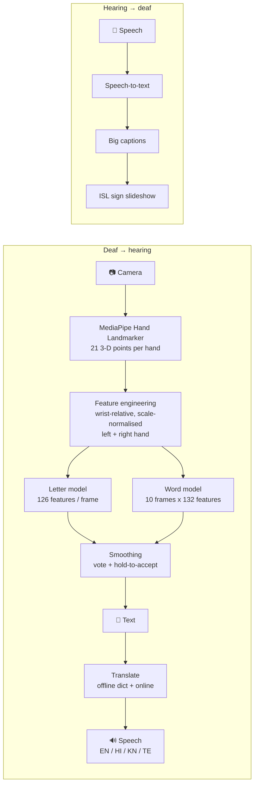
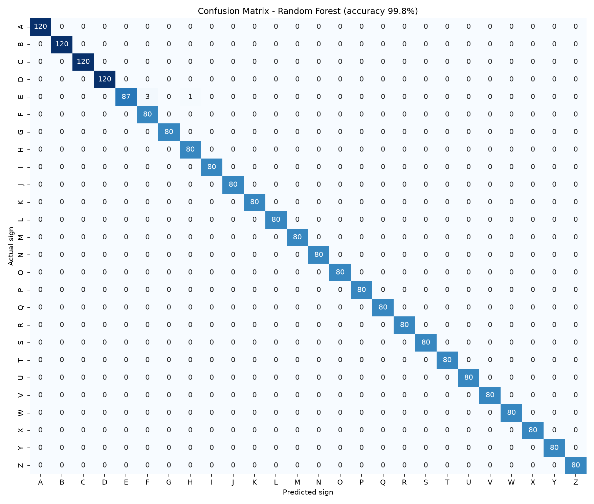
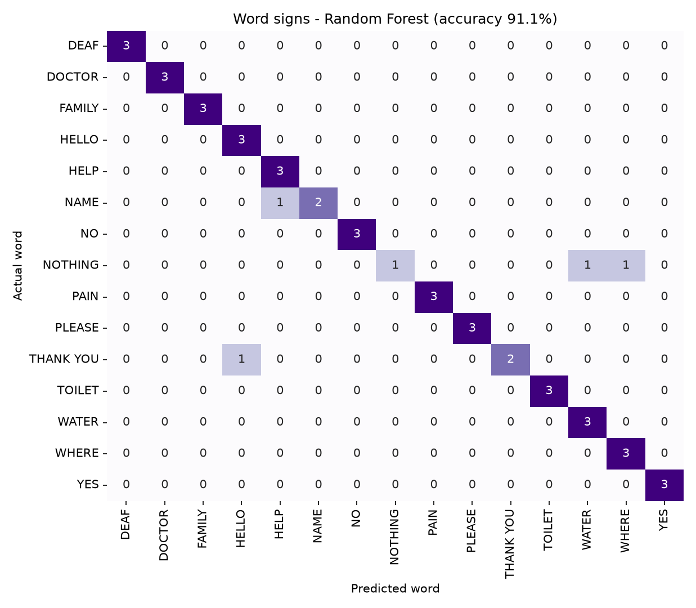
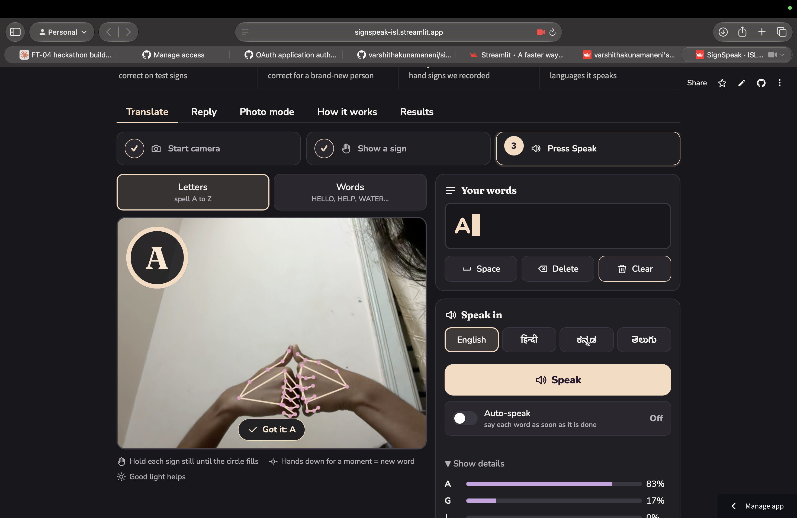
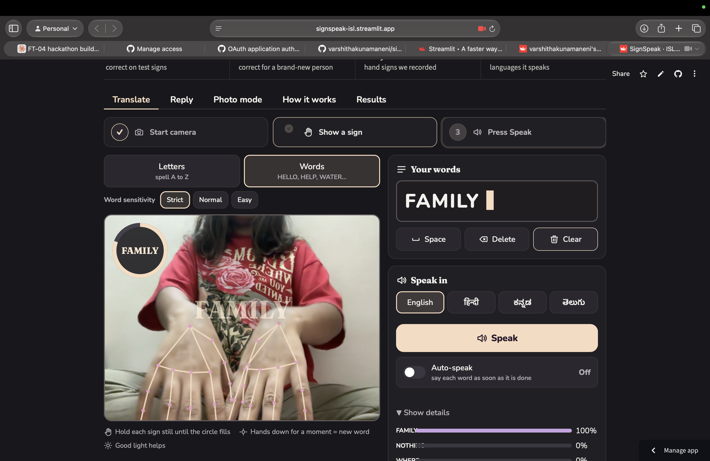
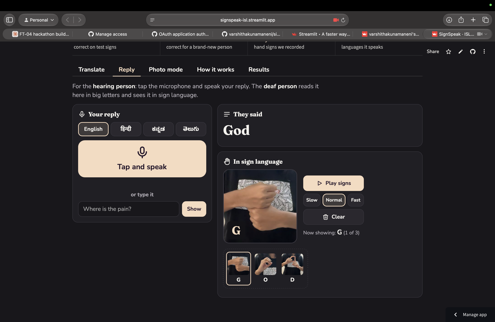
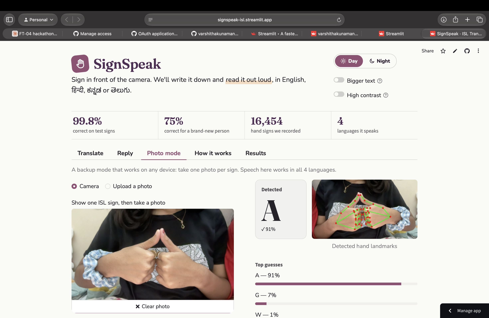

# 🤟 SignSpeak: Indian Sign Language ⇄ Text & Speech

**Problem Statement:** FT-04 · Sign Language to Text/Speech Translator
**Track:** Track 1 · Future Tech (Intelligent Systems & Emerging Technology)
**Hackathon:** Neural Storm 2026

🔗 **Live demo:** [TEAM: paste your Streamlit link, e.g. https://signspeak-isl.streamlit.app]
🎬 **Demo video:** [TEAM: paste your video link]


---

## 👥 Team

**Team name:** [TEAM: your team name]

| Member | Role |
|---|---|
| Varshitha [TEAM: full name] | [TEAM: role] |
| Pranitha [TEAM: full name] | [TEAM: role] |
| Akshitha [TEAM: full name] | [TEAM: role] |
| [TEAM: add / remove rows] | |

---

## ❗ The problem

India has a large deaf and hard-of-hearing community. Estimates range from **about 1.3 million (Census 2011) to about 18 million (National Association of the Deaf)**, yet only **a few hundred certified Indian Sign Language (ISL) interpreters** are listed with the government's ISL Research and Training Centre (ISLRTC).

Everyday moments become hard: explaining pain to a doctor, asking for help in an emergency, talking at a bank counter or in a classroom. Most hearing people don't know ISL, many deaf people find written Hindi or English difficult, and most sign-recognition tools target **American** Sign Language, not ISL.

## 💡 Our solution

**SignSpeak** turns any laptop or phone camera into a **two-way ISL interpreter**:

| Direction | How |
|---|---|
| **Deaf → hearing** | Sign ISL letters or whole words → AI recognises them in real time → text → **spoken aloud** in English, Hindi, Kannada or Telugu |
| **Hearing → deaf** | The hearing person **speaks** (or types) → big text **plus ISL sign pictures** played one letter at a time |

### ✨ Features
- 🔴 **Real-time translation in the browser.** Hand tracking and our trained models run on the user's device: fast, private (video never leaves the device), and works on phones.
- ✋ **Letters mode:** the full ISL alphabet A–Z, including **two-handed** letters.
- 👋 **Words mode:** 15 whole-word gestures (HELLO, THANK YOU, PLEASE, YES, NO, HELP, DOCTOR, PAIN, WATER, FOOD, TOILET, WHERE, FAMILY, NAME, DEAF), recognised from **hand movement over time**.
- 💬 **Reply tab (two-way conversation):** speech-to-text with large captions and an **ISL sign slideshow** built from photos of our team signing each letter.
- 🔊 **Speech in 4 languages** with an **offline dictionary**, so common and emergency words translate even without internet.
- ⚡ **Auto-speak** (optional): speaks each word as soon as it is finished.
- 🎚️ **Word sensitivity** (Strict / Normal / Easy) to balance responsiveness against false detections.
- 🧠 **Stability smoothing:** a letter is accepted only after it is predicted consistently for about 1 second, and a progress ring shows the user to "keep holding".
- 🫱 **Left-handed signer support** through mirror augmentation.
- ♿ **Accessible design:** Day / Night modes, bigger text, high-contrast mode, keyboard shortcuts, screen-reader labels, icons plus words (never colour alone), and a visual flash instead of sound when a letter is added.
- 📷 **Photo mode** (backup for any device) and a 🖥️ **desktop app** (OpenCV).

---

## 🏗️ How it works



1. **Hand tracking:** Google MediaPipe detects up to two hands and returns 21 (x, y, z) landmarks each.
2. **Feature engineering:** landmarks are made **relative to the wrist** and **scaled** to [-1, 1], so predictions don't depend on where the hand is or how far away it is. Left and right hands fill fixed slots (126 values).
3. **Letters:** a classifier on a single frame (Random Forest vs Neural Network compared).
4. **Words:** each 1.5 s clip is resampled to **10 frames**. Each frame also includes **hand position and size** (132 values), so the model learns *where* and *how* the hands move.
5. **Training tricks:** noise and scale augmentation, **mirroring** (left-handed signers), and timing shifts for words.
6. **Browser deployment:** the neural networks are trained in **Python (scikit-learn)** and their weights exported to JSON. The same maths runs in JavaScript, and our tests confirm the browser and Python predictions match (difference < 0.0001).
7. **Smoothing:** a majority vote plus a hold timer for letters; confidence, lead over the 2nd guess, a "not signing" check, and consecutive agreement for words.

---

## 📊 Dataset & results

### Our own ISL dataset
We **recorded our own dataset** with our tools (`collect_data.py`, `collect_words.py`, `capture_signs.py`).

| | Letters | Words |
|---|---|---|
| Classes | 26 (A–Z) | 15 words + "nothing" |
| Signers | 3 | [TEAM: number] |
| Samples | 16,454 frames | [TEAM: number from train_words.py] clips |

### Letters: model comparison (held-out 20% test set)

| Model | Accuracy | Macro F1 |
|---|---|---|
| **Random Forest** (selected) | **99.82%** | **99.81%** |
| Neural Network (MLP) | 99.70% | 99.69% |
| Browser model (MLP, exported) | 99.79% | – |



### Honest evaluation: a brand-new signer
A random split is optimistic, because frames from the same person look alike. So we also run a **leave-one-signer-out** test: train on everyone except one person, then test on that person.

| Version | Signers | Accuracy on an unseen person |
|---|---|---|
| First model | 2 | 63.9% |
| **+ 3rd signer + left-hand mirroring** | **3** | **74.7%** |

*Per signer: 79.9%, 77.1%, 67.1%.* Finding this gap and closing it by **+10.8 points** was one of our key learnings. More signers continue to improve it.

### Words (held-out test set)

| Model | Accuracy |
|---|---|
| **Random Forest** | **91.1%** |
| Unseen-signer accuracy | [TEAM: from train_words.py, if 2+ signers] |

11 of 15 words scored a perfect F1 on the test set.



---

### ⚡ Speed (latency)
Measured with `python src/benchmark.py` on our laptop:

| Step | Time |
|---|---|
| Hand tracking (MediaPipe, one 640×480 frame) | [TEAM: from benchmark.py] ms |
| Letter model in the browser (one frame) | [TEAM] ms |
| Word model in the browser (one 10-frame clip) | [TEAM] ms |
| **Live app speed** (Translate → Show details) | [TEAM: e.g. 25–30] frames per second |

So recognition runs in **real time** on an ordinary laptop, with no GPU and no server.

### 🔍 Explainability
- The app shows its **top-3 guesses with confidence** for every frame (Translate → *Show details*, and Photo mode).
- A **progress ring** shows how sure and how stable the current guess is before it is accepted.
- **Confusion matrices** (above, and in the app's Results tab) show exactly which signs get mixed up.

### ✅ Tests
`python -m pytest -q` runs 13 automated tests: feature extraction (position and size invariance, left/right hand slots), mirror augmentation, clip resampling, translation, and a check that the **browser model gives the same predictions as scikit-learn**.

---

## ⚠️ Limitations & responsible AI
SignSpeak touches health and emergency communication, so we are explicit about what it can and can't do:
- **Not a replacement for a certified ISL interpreter.** It is a prototype that can make mistakes. In medical, legal or emergency situations, use a professional interpreter or call **112**. The app shows this notice on every page.
- **Limited vocabulary:** ISL A–Z plus 15 words. ISL has 10,000+ signs, and regional variations may not be recognised.
- **Accuracy for new people is lower** (≈75% per letter on an unseen signer, vs 99.8% on our test split). We report this honestly, reduce its impact with smoothing, confidence thresholds and "Strict" word sensitivity, and let users review and delete text before speaking (Auto-speak is **off** by default).
- **Small, young dataset:** 3 signers of similar age, recorded indoors. It needs more diverse signers (age, skin tone, hand size, lighting) to be fair to everyone.
- **Conditions:** poor light, busy backgrounds or fast movement reduce accuracy.
- **Privacy:** live mode runs entirely in the browser, and video is never uploaded or stored. Only hand-point coordinates are used. Signer names in our dataset are replaced with *signer_1…3* (`src/anonymize.py`), and the sign photos are cropped to the hands.

---

## 🛠️ Technology stack

| Area | Tools |
|---|---|
| Language | **Python 3.11** for all AI/ML (data collection, training, evaluation, export) |
| Hand tracking | MediaPipe Tasks: Hand Landmarker (Python + JavaScript) |
| Machine learning | scikit-learn (Random Forest, MLP, StandardScaler), NumPy, pandas |
| Computer vision | OpenCV |
| Evaluation & charts | scikit-learn metrics, Matplotlib, Seaborn |
| Web app | Streamlit, HTML / CSS / JavaScript components |
| Speech | gTTS, Web Speech API (speech synthesis and recognition), macOS `say` / pyttsx3 |
| Translation | Offline dictionary + deep-translator (Google / MyMemory fallback) |
| Deployment | Streamlit Community Cloud |

---

## 📁 Project structure

```
sign-language-translator/
├── app.py                     # Streamlit web app (Translate, Reply, Photo mode, How it works, Results)
├── web/
│   ├── live.html              # Real-time translator (letters + words) running our models in the browser
│   ├── reply.html             # Two-way conversation: speech → captions + ISL slideshow
│   └── signs/                 # Our photos of each ISL letter (A.jpg … Z.jpg)
├── src/
│   ├── utils.py               # Hand detection + feature extraction (letters and words)
│   ├── collect_data.py        # Record letter samples
│   ├── collect_words.py       # Record word-sign clips
│   ├── capture_signs.py       # Photograph each ISL letter for the Reply tab
│   ├── fix_names.py           # Fix signer names in the dataset
│   ├── train.py               # Train letters, compare models, unseen-signer test
│   ├── train_words.py         # Train words, unseen-signer test, export for browser
│   ├── export_web_model.py    # Export the letter neural network for the browser
│   ├── translate.py           # Offline + online translation (hi / kn / te)
│   ├── realtime.py            # Desktop real-time translator with speech
│   ├── anonymize.py           # Replace signer names with signer_1, 2, 3 (privacy)
│   ├── benchmark.py           # Measure speed (latency) of each step
│   └── pin_requirements.py    # Pin exact library versions
├── tests/test_core.py         # Automated tests (python -m pytest -q)
├── data/                      # landmarks.csv (letters), words.csv (words)
├── models/                    # sign_model.joblib, web_model.json, words_web_model.json
├── assets/                    # Confusion matrices, metrics, screenshots
├── .streamlit/config.toml     # Day / Night colours
├── requirements.txt           # Pinned library versions
├── packages.txt               # System packages for Streamlit Cloud
└── LICENSE                    # MIT
```

---

## ⚙️ Setup & installation

**Requirements:** Python 3.10–3.12, a webcam, and internet for the first run (downloads the 7.5 MB hand model).

```bash
git clone https://github.com/varshithakunamaneni/sign-language-translator.git
cd sign-language-translator

python3 -m venv venv
source venv/bin/activate          # Windows: venv\Scripts\activate

pip install -r requirements.txt
```

## ▶️ Running locally

**Web app:**
```bash
streamlit run app.py
```
Open http://localhost:8501:
- **Translate** → choose **Letters** or **Words** → **Start camera** → sign → **Speak** (or turn on Auto-speak)
- **Reply** → tap **Tap and speak** → the deaf person sees captions and the ISL slideshow

**Desktop translator:**
```bash
python src/realtime.py
```
Hold a sign ≈1 s to add it · hands down ≈1.5 s = space · **Enter** speak · **Backspace** delete · **C** clear · **Q** quit

**Run the tests / measure speed:**
```bash
python -m pytest -q
python src/benchmark.py
```

**Retrain with your own data:**
```bash
# letters
python src/collect_data.py --person yourname --labels A-Z --samples 150
python src/train.py && python src/export_web_model.py
# words
python src/collect_words.py --person yourname --words HELLO "THANK YOU" WATER NOTHING
python src/train_words.py
# letter photos for the Reply tab
python src/capture_signs.py
```

---

## 📸 Screenshots

| Translate: letters | Translate: words |
|---|---|
|  |  |

| Reply (two-way) | Day mode |
|---|---|
|  |  |

---

## 🔮 Future work
- Record more signers of different ages, hand sizes and lighting conditions to raise unseen-signer accuracy further.
- Expand the word vocabulary using the ISLRTC dictionary (10,000+ signs) and a sequence model (LSTM / Transformer).
- Turn sign-word sequences into grammatical sentences ("ME WATER" → "I need water").
- An offline mobile app for places with poor internet.

---

## 🤖 Disclosure of AI tools used
As required by the hackathon rules: we used **Claude (by Anthropic)** as an AI assistant during development, for project planning, code generation, debugging, UI design and drafting this README. All data collection (letters, words and sign photos), model training, testing, evaluation, tuning and integration were done by our team during the hackathon. [TEAM: add any other AI tools you used.]

## 📄 License
MIT. See [LICENSE](LICENSE).

## 🙏 Acknowledgements
- [Google MediaPipe](https://developers.google.com/mediapipe) for hand landmark detection
- Indian Sign Language Research and Training Centre (ISLRTC) for ISL reference videos
- Statistics: Census of India 2011; National Association of the Deaf; ISLRTC interpreter directory (as reported by MultiLingual and Punarbhava)
